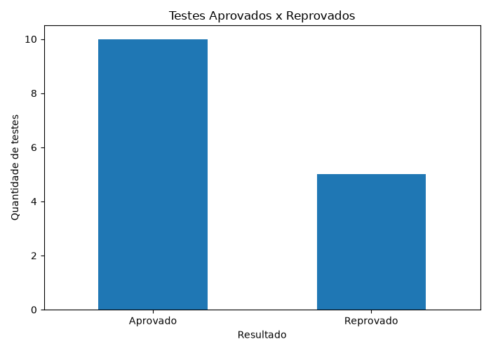
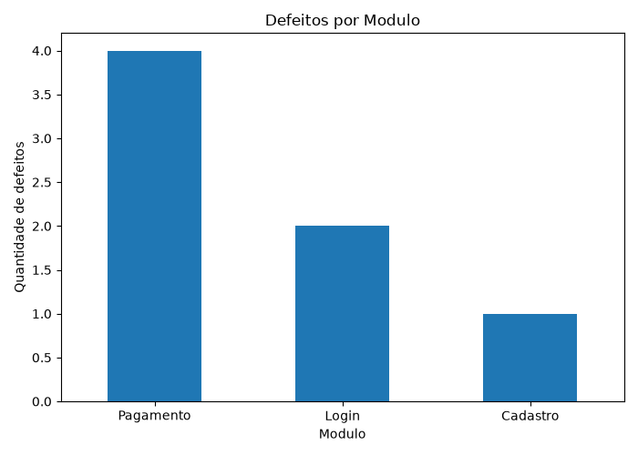
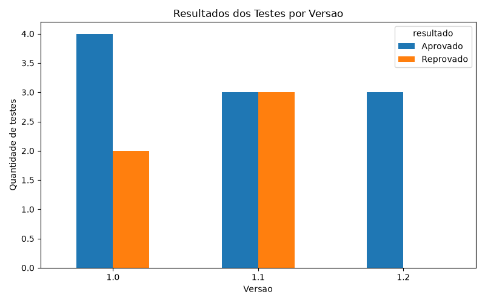

# Análise de Qualidade de Software

## Sobre o projeto

Este projeto utiliza Python para analisar resultados fictícios de testes de software, identificar defeitos e gerar indicadores de qualidade.

O objetivo é transformar dados de testes em informações que facilitem a identificação de falhas e apoiem a tomada de decisão.

## Tecnologias utilizadas

- Python
- Pandas
- Matplotlib
- Git e GitHub

## Indicadores analisados

- Total de testes executados
- Quantidade de testes aprovados e reprovados
- Taxa de aprovação
- Total de defeitos identificados
- Resultados por módulo
- Resultados por versão do sistema

## Principais resultados

- Total de testes: 15
- Testes aprovados: 10
- Testes reprovados: 5
- Taxa de aprovação: 66,67%
- Total de defeitos: 7
- Módulo com mais defeitos: Pagamento

## Gráficos

### Testes aprovados e reprovados



### Defeitos por módulo



### Resultados por versão



## Como executar

Instale as bibliotecas necessárias:

```bash
pip install pandas matplotlib
```

Execute o script:

```bash
python analise_qualidade.py
```

## Observação

Os dados utilizados são fictícios e foram criados exclusivamente para fins de estudo e demonstração.

## Autor

André Almeida
